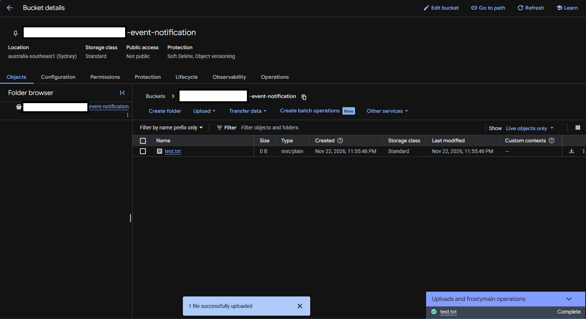
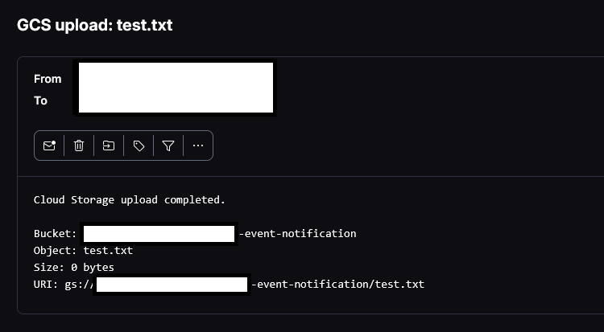

# GCP 検証案

下記、GCP 検証案の概要です。
それぞれterraformで実装していっています。

# 検証案①: Cloud Storage → Cloud Run → Gmail

- 1: ファイルをCloud Storage にアップロードする。
- 2: Eventarc でイベントを受け取り、Cloud Runに渡す
- 3: Cloud Run から Gmail で通知(ファイル名 + 容量が本文に記載)

# 実装結果

- 1: Cloud Storage へのファイルのアップロード結果
 

</img>

- 2: Cloud Run実行ログ
 

</img>

- 3: Gmail通知内容
 

</img>

# 検証案②: Cloud Function → Pub/Sub → Gmail

検証中。

# 検証案③: Youtube data → Cloud Function → Cloud Storage → BigQuery → グラフダウンロード 

検証中。
