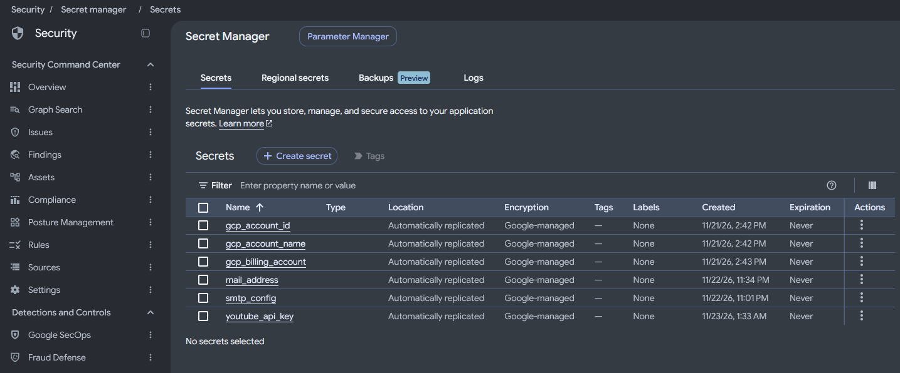
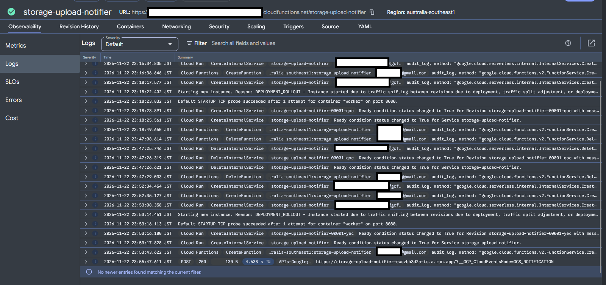

# GCP 検証案

下記、GCP 検証案の概要です。
それぞれterraformで実装していっています。

Secret Manager に保存したシークレットを利用する構成です。

</img>


# 検証案①: Cloud Storage → Cloud Run → Gmail

- 1: ファイルをCloud Storage にアップロードする。
- 2: Eventarc でイベントを受け取り、Cloud Runに渡す
- 3: Cloud Run から Gmail で通知(ファイル名 + 容量が本文に記載)


# 実装結果

- 1: Cloud Storage へのファイルのアップロード結果
<br />

</img>

- 2: Cloud Run実行ログ
<br />

</img>

- 3: Gmail通知内容
<br />

</img>


# 検証案②: Cloud Function → Pub/Sub → Gmail

検証中。

<br />


# 検証案③: Youtube data → Cloud Function → Cloud Storage → BigQuery → グラフダウンロード 

## Cloud Storage への CSV 出力

- Cloud Scheduler が毎日 09:00（日本時間）に HTTP Cloud Function を実行
- 登録した検索語ごとに YouTube Data API v3 で動画を最大 10 件検索
- 検索日時、動画 ID、タイトル、チャンネル、公開日時、URL などを 1 つの CSV にまとめる
- CSV を `{project_id}-youtube-summary-storage` バケットの `youtube-search/YYYY/MM/DD/` 配下へ保存
- BigQuery への取り込みとグラフ出力は次段階で追加予定

初期検索語は `GCP Cloud Run` です。`terraform.tfvars` で変更できます。

```hcl
youtube_search_terms = ["GCP Cloud Run", "Google Cloud"]
youtube_result_limit = 10
youtube_schedule     = "0 9 * * *"
```

YouTube Data API キーはコードや `tfvars` に保存せず、Terraform の `gcp_secret_project_id`
で指定したプロジェクトの Secret Manager に `youtube_api_key` という名前で登録してください。

```sh
gcloud secrets create youtube_api_key \
  --project=parameter-store-505395
printf '%s' 'YOUR_YOUTUBE_DATA_API_KEY' | \
  gcloud secrets versions add youtube_api_key \
  --data-file=- \
  --project=parameter-store-505395
```
